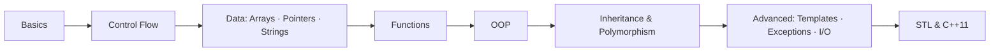

<div align="center">

# 📘 C++ Deep Dive

**A topic-by-topic C++ reference: working programs and study notes, from first `cout` to smart pointers.**


</div>

---

## ✨ About

I made this repo while working through Abdul Bari's [*Learn C++ Programming – Beginner to Advance – Deep Dive in C++*](https://www.udemy.com/course/learn-cpp-programming/) on Udemy. The programs are my own practice code, written and modified while following the course, and the notes are my own study notes. Each module pairs example programs with notes, so you can read a concept and run the code side by side.

I use it to revise, and I'm sharing it in case it helps other beginners too.

## 🗺️ Learning path



## 📚 Modules

Each folder contains `.cpp` examples and a `docs-notes/` directory with PDF notes.

| Stage | Modules | You'll find |
|:--|:--|:--|
| **Foundations** | `01-CPP-Basics` · `02-Conditional-Statements` · `03-Loops` | Operators, if/switch, patterns, prime, GCD |
| **Data** | `04-Arrays` · `05-Pointers` · `06-Strings` | Matrices, pointer arithmetic, references, `std::string` |
| **Functions** | `07-Functions` | Overloading, default args, recursion, call by value/address/reference |
| **Object-Oriented** | `08-OOP` · `09-Operator-Overloading` · `10-Inheritance` · `11-Base-Class-Pointer` · `12-Polymorphism` · `13-Friend-Static-Inner` | Classes, inheritance, virtual functions, abstract classes |
| **Advanced** | `14-Exception-Handling` · `15-Templates` · `16-Constants-Preprocessor-Namespaces` · `17-Destructor` · `18-IO-Streams` | try/catch, class templates, file I/O, serialization |
| **Modern C++** | `19-STL` · `20-CPP11-Features` · `21-Miscellaneous` | Vectors, maps, lambdas, smart pointers, `auto` |

## 🔎 Quick find

| Looking for… | Go to |
|:--|:--|
| Pointers | [`05-Pointers/03 - pointers.cpp`](05-Pointers/03%20-%20pointers.cpp) |
| Virtual functions | [`12-Polymorphism/06 - virtual functions demo1.cpp`](12-Polymorphism/06%20-%20virtual%20functions%20demo1.cpp) |
| Operator overloading | [`09-Operator-Overloading/04 - insertion op overloading.cpp`](09-Operator-Overloading/04%20-%20insertion%20op%20overloading.cpp) |
| Exceptions | [`14-Exception-Handling/06 - throw and catch.cpp`](14-Exception-Handling/06%20-%20throw%20and%20catch.cpp) |
| Class templates | [`15-Templates/01 - template stack.cpp`](15-Templates/01%20-%20template%20stack.cpp) |
| File I/O | [`18-IO-Streams/08 - write file.cpp`](18-IO-Streams/08%20-%20write%20file.cpp) |
| STL map | [`19-STL/01 - map stl.cpp`](19-STL/01%20-%20map%20stl.cpp) |
| Lambdas | [`20-CPP11-Features/03 - lambda function.cpp`](20-CPP11-Features/03%20-%20lambda%20function.cpp) |
| Smart pointers | [`20-CPP11-Features/04 - smart pointers.cpp`](20-CPP11-Features/04%20-%20smart%20pointers.cpp) |

## 🚀 Getting started

```bash
git clone https://github.com/supreetvardhamane/cpp-deep-dive.git
cd cpp-deep-dive

g++ -std=c++11 "01-CPP-Basics/01 - area of circle.cpp" -o example
./example
```

**Requirements:** any C++11-compatible compiler (GCC, Clang, or MSVC).
Some programs in `18-IO-Streams` read from the `.txt` files in the same folder, so run them from that directory.

## 🧭 How to use this repo

1. **Learning C++?** Follow the modules in order, reading the notes first and then running the code.
2. **Revising?** Use the Quick find table or jump straight to a module.
3. **Experimenting?** Change the examples and recompile. Breaking them on purpose is a great way to learn.

## 🤝 Contributing

I'm still a student and still learning, so if you spot a mistake or a better way to write something, please open an issue or a pull request. I'd really appreciate it.

## 📄 License & Credits

- The code and notes here are my personal study work, released under the [MIT License](LICENSE).
- The course content, teaching material, and original ideas belong to **Abdul Bari** and Udemy. This repo is an independent set of student notes and is not affiliated with or endorsed by either. If you want to learn C++ properly, take the [original course](https://www.udemy.com/course/learn-cpp-programming/).
- If you are the rights holder and want anything changed or removed, please open an issue and I'll take care of it promptly.

---

<div align="center">

Made while learning C++ 💻 If it helped you, a ⭐ would make my day.

[@supreetvardhamane](https://github.com/supreetvardhamane)

</div>
